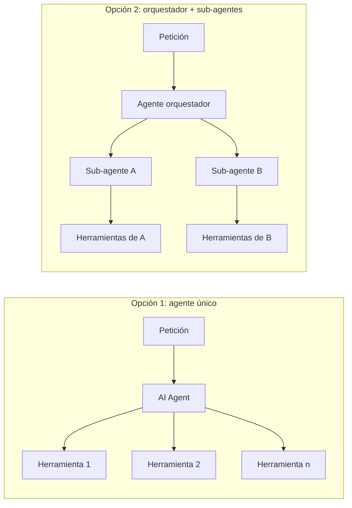

# Programación orientada a objetos y agentes de inteligencia artificial como orquestadores en n8n

**Primer trabajo investigativo**

Rossman Doan Rivera Cano
FORWARD Costa Rica
Programación con énfasis en Inteligencia Artificial
Programación Orientada a Objetos
Profesor: Steven Ledezma
20 de octubre de 2026

---

## Resumen

Esta investigación analiza cómo los principios de la programación orientada a objetos (POO) pueden aplicarse en n8n, una plataforma de automatización de flujos de trabajo, y cómo un agente de inteligencia artificial (IA) basado en un modelo de lenguaje puede actuar como orquestador de esos flujos. Se parte de los dos documentos entregados por el profesor, cuyas afirmaciones técnicas se verificaron contra la documentación oficial de n8n, el código fuente de la versión 2.44.4 y literatura académica. Se comparan dos enfoques: (a) la POO como analogía para diseñar y organizar workflows, y (b) la POO implementada con clases reales de JavaScript dentro de nodos Code. Ambos se evalúan en cuatro dimensiones de eficiencia: velocidad de ejecución, tiempo de desarrollo, mantenimiento y reutilización, y costo. Se concluye que los enfoques son complementarios: la analogía organiza el sistema a nivel de arquitectura, mientras que las clases en código concentran la lógica de negocio con menor costo de ejecución. Finalmente, se proponen criterios para elegir un caso de negocio, se ilustran con seis facturas de ejemplo de empresas ficticias y se describen, sin seleccionarlas, las alternativas tecnológicas para una etapa posterior de desarrollo.

*Palabras clave:* programación orientada a objetos, n8n, agentes de IA, orquestación, automatización de flujos de trabajo

---

## Contenido

1. Introducción
2. Marco teórico
3. Análisis crítico de las fuentes del curso
4. La POO en n8n: dos enfoques
5. Análisis de eficiencia
6. El agente de IA como orquestador
7. Casos de negocio posibles
8. Alternativas tecnológicas para una etapa posterior
9. Conclusiones y recomendaciones
10. Referencias
11. Anexo: facturas de ejemplo

---

## 1. Introducción

### 1.1 Planteamiento del problema

Las herramientas de automatización visual como n8n permiten construir procesos conectando nodos, sin escribir un programa completo. Esto facilita el desarrollo, pero plantea una pregunta para la ingeniería de software: ¿cómo mantener ordenado, reutilizable y comprensible un sistema que crece en decenas de flujos? La programación orientada a objetos ofrece principios probados para organizar software (Gamma et al., 1994; Meyer, 1997), pero n8n no es un lenguaje orientado a objetos.

Al mismo tiempo, los modelos de lenguaje permiten crear agentes que deciden qué acciones ejecutar a partir de una petición en lenguaje natural (Yao et al., 2023). Integrar un agente como "orquestador" promete flexibilidad, pero introduce no determinismo, costos por uso y riesgos de seguridad (OWASP Foundation, 2024; Schluntz y Zhang, 2024).

### 1.2 Objetivos

**Objetivo general.** Analizar cómo aplicar los principios de la POO en n8n y cómo un agente de IA puede orquestar flujos de trabajo, para fundamentar el diseño de un aplicativo posterior.

**Objetivos específicos.**

1. Verificar la exactitud técnica de los documentos entregados por el profesor.
2. Describir los conceptos de POO, workflows, n8n y agentes de IA con fuentes confiables.
3. Comparar la POO como analogía de diseño y la POO con clases en nodos Code.
4. Evaluar la eficiencia de ambos enfoques en velocidad, desarrollo, mantenimiento y costo.
5. Identificar casos de negocio posibles y criterios para elegir uno.

### 1.3 Alcance y metodología

La investigación es documental y analítica. Se usaron tres tipos de fuentes: documentación oficial de n8n y código fuente publicado de la versión 2.44.4 (n8n, 2026); literatura académica sobre POO, workflows y agentes; y, como fuentes secundarias, las guías técnicas citadas en los documentos del curso. Las fuentes no académicas se marcan como tales.

El análisis de eficiencia es **cualitativo**: no se realizaron mediciones en un sistema en funcionamiento. Las diferencias de rendimiento y costo se plantean como hipótesis justificadas, y en la sección 5.3 se propone un método para medirlas en la etapa de desarrollo. No se desarrolló ningún aplicativo como parte de esta investigación.

---

## 2. Marco teórico

### 2.1 Programación orientada a objetos

La POO organiza el software en **objetos** que agrupan datos (estado) y operaciones (comportamiento). Una **clase** es la definición a partir de la cual se crean objetos; un objeto es una **instancia** concreta de esa clase (Meyer, 1997). La literatura suele resumir el paradigma en cuatro pilares:

| Pilar | Definición | Analogía sencilla |
| --- | --- | --- |
| Encapsulamiento | Ocultar el estado interno y exponer solo operaciones controladas. | Un cajero automático: se usa la pantalla, no se toca el dinero dentro. |
| Abstracción | Mostrar lo esencial de un objeto y omitir los detalles. | Un control remoto muestra "subir volumen", no los circuitos. |
| Herencia | Una clase hija reutiliza y especializa el comportamiento de una clase padre. | Una "factura de exportación" es una factura con reglas extra. |
| Polimorfismo | Objetos distintos responden al mismo mensaje con comportamientos propios. | "Enviar" funciona distinto por correo, por SMS o por WhatsApp. |

Gamma et al. (1994) agregan un principio práctico: **preferir la composición a la herencia**, es decir, construir comportamiento combinando objetos en lugar de extender jerarquías profundas. Este principio es importante para n8n, donde la composición de flujos es natural y la herencia no existe.

En JavaScript, el lenguaje del curso, las clases se declaran con `class`, admiten herencia con `extends`, campos privados con `#` y métodos estáticos (MDN Web Docs, s.f.). Es una sintaxis sobre el modelo de prototipos del lenguaje.

### 2.2 Workflows y automatización

Un **workflow** (flujo de trabajo) es la secuencia de actividades, decisiones y datos que componen un proceso. Van der Aalst et al. (2003) identificaron patrones de control recurrentes en los sistemas de workflow, como la secuencia, la división paralela, la elección exclusiva y la sincronización. Estos patrones permiten describir un flujo de forma independiente de la herramienta.

Cuando un proceso coordina varios servicios, existen dos estilos (Peltz, 2003):

- **Orquestación:** un coordinador central decide qué servicio se ejecuta y en qué orden. Es como un director de orquesta.
- **Coreografía:** cada participante sabe cuándo actuar según los mensajes que recibe, sin un coordinador central. Es como una pareja que baila sin que nadie dirija.

El agente de IA de este trabajo corresponde al estilo de **orquestación**.

### 2.3 n8n

n8n es una plataforma de automatización de workflows que puede usarse en la nube del fabricante o instalarse en servidores propios. Se distribuye bajo el modelo **fair-code**: el código fuente es público y su uso es gratuito en muchos escenarios, pero el autor restringe ciertos usos comerciales. Fair-code no es una licencia, sino un modelo; n8n lo aplica mediante la Sustainable Use License, que no es una licencia de código abierto aprobada por la OSI (Fair-code, s.f.).

Los conceptos de n8n relevantes para esta investigación son:

- **Nodo:** unidad que realiza una acción, como recibir una petición HTTP (Webhook), consultar una base de datos o ejecutar código.
- **Ítem:** cada registro JSON que viaja entre nodos.
- **Nodo Code:** ejecuta JavaScript o Python sobre los ítems. Tiene dos modos: una vez para todos los ítems o una vez por ítem (n8n, s.f.-b).
- **Sub-workflow:** un workflow que inicia con el disparador "When Executed by Another Workflow" y puede declarar sus entradas con el modo "Define using fields below". Otro workflow lo invoca con el nodo Execute Workflow.
- **Error Workflow:** un flujo con el nodo Error Trigger que se ejecuta cuando otro flujo falla.

**Cambios de la versión 2.0 relevantes** (n8n, s.f.-c):

- Python en el nodo Code ahora corre en "task runners" externos (imagen `n8nio/runners`). Se eliminó la versión Pyodide.
- Los botones Activar/Desactivar se reemplazaron por Publicar/Despublicar. Un flujo publicado llama a la versión publicada de sus sub-workflows.
- El nodo Code bloquea por defecto el acceso a variables de entorno.

### 2.4 Agentes de IA basados en modelos de lenguaje

Wooldridge y Jennings (1995) definen un agente como un sistema situado en un entorno, capaz de actuar de forma autónoma para cumplir sus objetivos. Russell y Norvig (2021) lo describen como algo que percibe su entorno y actúa sobre él.

Un **agente basado en un modelo de lenguaje** (LLM) usa el modelo como mecanismo de decisión. Recibe una petición y una lista de **herramientas** (funciones descritas con nombre, descripción y parámetros), decide cuál usar, observa el resultado y repite hasta poder responder. Este ciclo de razonar y actuar fue formalizado como **ReAct** por Yao et al. (2023), quienes mostraron que intercalar razonamiento y acciones mejora el desempeño en tareas que requieren información externa.

Schluntz y Zhang (2024) distinguen dos tipos de sistemas:

- **Workflows con LLM:** el modelo y las herramientas siguen caminos definidos de antemano en el código. Son predecibles.
- **Agentes:** el modelo decide sus propios pasos. Son flexibles, pero más lentos, más costosos y menos predecibles.

Su recomendación es usar la solución más simple que funcione y agregar autonomía solo cuando aporte valor.

**Riesgos principales** (OWASP Foundation, 2024):

- **Inyección de instrucciones:** texto malicioso dentro de un documento o mensaje que intenta cambiar el comportamiento del modelo. Es el riesgo número uno de la lista OWASP.
- **Salidas incorrectas o inventadas** ("alucinaciones").
- **Agencia excesiva:** el agente tiene permisos para hacer más de lo necesario.

### 2.5 El nodo AI Agent de n8n

El nodo AI Agent integra componentes de la biblioteca LangChain. Desde la versión 1.82.0, la opción de "tipo de agente" está obsoleta y el nodo funciona siempre como **Tools Agent** (n8n, s.f.-a). Sus piezas principales, verificadas en el código fuente de la versión 2.44.4 (n8n, 2026), son:

| Componente | Función |
| --- | --- |
| Chat Model | El modelo de lenguaje (OpenAI, Anthropic, Google, Groq, Ollama, entre otros). |
| System Message | Instrucciones y reglas permanentes del agente. |
| Memory | Historial de la conversación. "Simple Memory" (antes "Window Buffer Memory") guarda en la instancia; Postgres o Redis guardan de forma persistente. |
| Tools | Acciones disponibles. Incluye "Call n8n Workflow Tool" (un sub-workflow como herramienta), "AI Agent Tool" (un agente dentro de otro), "MCP Client Tool" y peticiones HTTP. |
| Output Parser | El "Structured Output Parser" exige una salida JSON con un esquema. |
| Opciones | "Max Iterations" (valor por defecto: 10), "Return Intermediate Steps", entre otras. |

La función `$fromAI()` permite que el modelo llene los parámetros de una herramienta. n8n también soporta el protocolo MCP (Model Context Protocol) con los nodos "MCP Client Tool" y "MCP Server Trigger", lo que permite exponer workflows a agentes externos o consumir herramientas externas.

---

## 3. Análisis crítico de las fuentes del curso

Los documentos del profesor son la presentación "El Agente Orquestador en n8n" (en adelante, P) y el documento "Primer trabajo investigativo" (en adelante, D). Sus afirmaciones se verificaron contra la documentación oficial, el código fuente de n8n 2.44.4 y la literatura citada.

### 3.1 Afirmaciones correctas

- n8n es fair-code, se puede usar en la nube o en servidores propios, y su nodo Code admite JavaScript y Python (D).
- El nodo AI Agent se basa en LangChain y recibe modelo, memoria, herramientas y parser de salida (P, D).
- "Max Iterations" tiene un valor por defecto de 10 (D).
- Existen las opciones "Return Intermediate Steps" y el "Structured Output Parser" (D).
- Existen "Call n8n Workflow Tool", el disparador "When Executed by Another Workflow" y el modo "Define using fields below" (P, D).
- n8n soporta MCP mediante "MCP Client Tool" (D).
- Existen el Error Workflow global y la opción por nodo "On Error: continue" (D).
- El ciclo razonar-actuar corresponde al concepto ReAct de Yao et al. (2023) (P, D).
- El modo cola con Redis y workers permite escalar instalaciones propias (D).

### 3.2 Afirmaciones correctas con matices

- **Python en el nodo Code (D).** Desde la versión 2.0 requiere task runners externos y es más lento que JavaScript (n8n, s.f.-b, s.f.-c).
- **Precios de n8n Cloud (D).** El documento indica 24 y 60 USD por mes. La página oficial, consultada el 20 de octubre de 2026, muestra €20 y €50 por mes con pago anual e indica un ahorro de 17 % frente al pago mensual, lo que equivale a unos €24 y €60 mensuales (n8n, s.f.-d). Las cifras coinciden, pero la moneda es el euro.
- **Sub-agentes como workflows (P).** Conectarlos con "Call n8n Workflow Tool" es válido. Existe además el nodo "AI Agent Tool", que permite anidar un agente sin crear un workflow aparte.
- **Ciclo ReAct en n8n (P, D).** El Tools Agent usa llamadas a herramientas en ciclo, una técnica inspirada en ReAct; no es una implementación literal del artículo.
- **Analogías de encapsulamiento, abstracción e interfaz (D).** Son razonables, pero deben presentarse como analogías, no como POO real (ver sección 4.1).
- **Polimorfismo mediante un nodo Switch (D).** Se parece más a una selección por tipo que al polimorfismo, donde cada objeto decide su propio comportamiento.

### 3.3 Afirmaciones desactualizadas o imprecisas

- **Tipos de agente SQL, Plan and Execute y conversacional (D).** Quedaron obsoletos en la versión 1.82.0; el nodo actual funciona como Tools Agent (n8n, s.f.-a).
- **"Window Buffer Memory" (P, D).** Hoy se llama "Simple Memory" y no es compatible con el modo cola; para producción se recomienda Postgres o Redis.
- **"Ollama requiere GPU" (D).** También puede ejecutarse en CPU, con menor velocidad.
- **"Con más de 10 a 15 herramientas el modelo se confunde" (D).** Es una recomendación práctica de guías técnicas, sin respaldo en una fuente primaria.

### 3.4 Afirmaciones incorrectas

- **"Herencia = workflow duplicado" (D).** Duplicar es copiar: si el original cambia, la copia no se actualiza, lo contrario de la herencia. En n8n, lo más cercano es la **composición** (un sub-workflow base reutilizado por otros), coherente con la recomendación de Gamma et al. (1994).
- **Workflow en JSON "importable" (D).** El extracto no puede importarse tal como está, porque le faltan conexiones, identificadores, posiciones y parámetros.
- **Identificadores fiscales RFC, NIT y RUC (D).** Corresponden a México, Colombia y Perú. En Costa Rica se usan la cédula física o jurídica y la moneda CRC.
- **Código de la presentación (P).** Está escrito en Python, aunque el curso usa JavaScript. Además, menciona una "Dataclass Resultado" que no aparece en el código y define un método `puede_manejar()` que no se utiliza.

### 3.5 Diferencias entre los documentos

| Aspecto | Presentación (P) | Documento (D) |
| --- | --- | --- |
| Arquitectura del agente | Orquestador con sub-agentes especialistas | Agente único con herramientas |
| Relación POO ↔ n8n | Clases en código (Python) que se integran con n8n | Analogía para organizar workflows |
| Caso de negocio | No lo define | Gestión de facturas |

Estas diferencias no son errores: representan alternativas. Las secciones 4 y 6 las comparan.

---

## 4. La POO en n8n: dos enfoques

### 4.1 Enfoque A: la POO como analogía para diseñar workflows

En este enfoque, los conceptos de la POO se usan para **organizar** el sistema, aunque n8n no los implemente de forma nativa.

| Concepto POO | Implementación en n8n | ¿Qué tan fiel es? |
| --- | --- | --- |
| Clase | Grupo de sub-workflows con un prefijo común (`WF_Factura_*`) o una carpeta | Débil: no hay una entidad "clase", solo una convención de nombres |
| Objeto | Ítem JSON con estructura estable; su estado persiste en una base de datos | Media: hay datos, pero no comportamiento unido a ellos |
| Método | Sub-workflow con entradas declaradas | Alta: tiene nombre, parámetros y una salida |
| Constructor | Nodo inicial que normaliza datos y asigna valores por defecto | Media |
| Encapsulamiento | Quien llama al sub-workflow solo ve entradas y salida | Alta |
| Abstracción | El agente solo ve nombre y descripción de cada herramienta | Alta |
| Interfaz | Todos los sub-workflows devuelven la misma estructura, por ejemplo `{ ok, data, error }` | Media: es una convención, nadie la obliga |
| Herencia | No existe. Se sustituye por composición: sub-workflows base reutilizables | No aplica |
| Polimorfismo | Un Switch elige la implementación según un parámetro | Débil a media |

**Ventajas.** Los flujos quedan visibles en el editor, cada "método" se puede probar por separado y personas sin experiencia en programación pueden entender la estructura. Cada sub-workflow se convierte naturalmente en una herramienta del agente.

**Limitaciones.** No hay compilador ni tipos que hagan cumplir la convención: si un sub-workflow devuelve una estructura distinta, nada lo detecta antes de ejecutarlo. Tampoco hay herencia real, y cada llamada a un sub-workflow crea una ejecución adicional, lo que tiene un costo de rendimiento (sección 5).

### 4.2 Enfoque B: clases reales de JavaScript dentro del nodo Code

En este enfoque, la lógica de negocio se escribe como clases de JavaScript dentro de un nodo Code. La POO es real: hay clases, herencia, campos privados y polimorfismo del lenguaje.

Ejemplo ilustrativo (no forma parte de un aplicativo):

```javascript
// Nodo Code — modo "Run Once for All Items"
class Documento {
  #total;
  constructor({ numero, subtotal, impuestos }) {
    this.numero = numero;
    this.subtotal = Number(subtotal);
    this.impuestos = Number(impuestos);
    this.#total = this.subtotal + this.impuestos;
  }
  get total() { return this.#total; }
  validar() {
    const errores = [];
    if (!this.numero) errores.push('Falta el número');
    if (this.subtotal < 0) errores.push('Subtotal negativo');
    return errores;
  }
}

class Factura extends Documento {            // herencia real
  validar() {                                // polimorfismo: redefine el método
    const errores = super.validar();
    if (this.impuestos > this.subtotal * 0.13 + 1) errores.push('IVA mayor al 13 %');
    return errores;
  }
}

return $input.all().map((item) => {
  const factura = new Factura(item.json);
  return { json: { numero: factura.numero, total: factura.total, errores: factura.validar() } };
});
```

**Ventajas.** Se aplican los cuatro pilares de verdad, la lógica queda concentrada en un solo lugar y todo ocurre dentro de una sola ejecución, sin el costo de invocar sub-workflows.

**Limitaciones.**

- Las clases definidas en un nodo Code **no se comparten** con otros nodos ni con otros workflows: si dos flujos necesitan la clase `Factura`, hay que copiarla, con el mismo problema de duplicación señalado en la sección 3.4.
- En instalaciones propias se pueden habilitar módulos externos, lo que permitiría compartir código; en la nube de n8n, JavaScript solo puede usar el módulo `crypto` y el paquete `moment` (n8n, s.f.-b).
- El nodo Code no puede acceder al sistema de archivos ni hacer peticiones HTTP; para eso se usan otros nodos.
- La lógica deja de verse en el editor visual: se vuelve una "caja negra" para quien no lee el código.

### 4.3 Comparación de los enfoques

| Criterio | A: Analogía con sub-workflows | B: Clases en nodo Code |
| --- | --- | --- |
| Fidelidad a la POO | Parcial (analogía) | Completa |
| Visibilidad en el editor | Alta | Baja |
| Reutilización entre workflows | Alta (un sub-workflow se llama desde cualquier flujo) | Baja (el código se copia) |
| Integración con el agente | Directa: cada sub-workflow es una herramienta | Indirecta: hay que envolver el nodo en un sub-workflow |
| Pruebas | Por sub-workflow, desde el editor | Por clase, con pruebas de código |
| Herencia | No | Sí |

### 4.4 Enfoque combinado

Los enfoques no son excluyentes. Una arquitectura combinada usa sub-workflows como "métodos públicos" que el agente puede invocar (enfoque A), y dentro de cada sub-workflow usa clases de JavaScript para la lógica de negocio (enfoque B). Así se obtiene la organización visible del enfoque A y la POO real del enfoque B. Su costo es mantener dos niveles de diseño.

La presentación del profesor menciona además un tercer camino: escribir las clases en un servicio externo (por ejemplo, una API) que n8n invoca con el nodo HTTP Request. Ofrece POO completa y código compartido, pero agrega un servidor más que desplegar y mantener.

---

## 5. Análisis de eficiencia

### 5.1 Dimensiones evaluadas

La eficiencia se analizó en cuatro dimensiones: velocidad de ejecución, tiempo de desarrollo, mantenimiento y reutilización, y costo. Como no se midió un sistema real, cada resultado es una **valoración cualitativa** basada en el funcionamiento documentado de n8n y en la literatura.

### 5.2 Resultados

| Dimensión | A: Sub-workflows | B: Clases en Code | Combinado | Justificación |
| --- | --- | --- | --- | --- |
| Velocidad de ejecución | Menor | Mayor | Media | Cada llamada a un sub-workflow inicia una ejecución adicional; el código en un solo nodo evita ese paso. JavaScript es más rápido que Python en el nodo Code (n8n, s.f.-b). |
| Tiempo de desarrollo | Menor para flujos simples | Menor para reglas complejas | Mayor al inicio | Conectar nodos es rápido; expresar muchas reglas con nodos IF y Switch se vuelve lento y difícil de leer. |
| Mantenimiento y reutilización | Mayor | Menor | Mayor | Un sub-workflow se reutiliza desde cualquier flujo; una clase en un nodo Code se copia. |
| Costo de IA | Depende del diseño | Depende del diseño | Menor si se diseña bien | Ver explicación abajo. |

**Costo de IA.** El costo de un agente depende del número de llamadas al modelo, y cada uso de una herramienta suele requerir al menos una llamada adicional. Si el agente debe encadenar muchos métodos pequeños (enfoque A con granularidad fina), el costo y el tiempo de respuesta aumentan. Si un método agrupa varias reglas deterministas (enfoque B dentro de un sub-workflow), el agente hace menos llamadas. Esto coincide con la recomendación de Schluntz y Zhang (2024) de reservar las decisiones del modelo para lo que realmente requiere flexibilidad.

**Costo de infraestructura.** Ambos enfoques funcionan con la edición gratuita autoalojada. En n8n Cloud, los planes limitan las ejecuciones por mes (2 500 en Starter y 10 000 en Pro según la página consultada; n8n, s.f.-d). Si cada sub-workflow se contabiliza como ejecución, el enfoque A consumiría el límite más rápido; esto debe confirmarse con el fabricante antes de elegir el plan.

### 5.3 Método propuesto para medir la eficiencia

Para validar estas hipótesis en la etapa de desarrollo se propone:

1. Implementar la misma regla de negocio (por ejemplo, validar una factura) con los dos enfoques.
2. Ejecutar cada versión con el mismo conjunto de facturas de prueba (por ejemplo, las seis del anexo, repetidas 50 veces).
3. Registrar el tiempo de ejecución que reporta n8n en su historial de ejecuciones.
4. Contar las llamadas al modelo y los tokens consumidos por petición.
5. Medir el esfuerzo de un cambio: el tiempo que toma agregar una regla nueva en cada enfoque.

---

## 6. El agente de IA como orquestador

### 6.1 Agente único frente a orquestador con sub-agentes



| Criterio | Agente único (documento D) | Orquestador con sub-agentes (presentación P) |
| --- | --- | --- |
| Complejidad | Baja | Alta |
| Llamadas al modelo | Menos | Más: cada sub-agente razona por su cuenta |
| Latencia y costo | Menores | Mayores |
| Cuándo conviene | Pocas herramientas y un solo dominio | Muchas herramientas o dominios distintos |
| Implementación en n8n | Un AI Agent con varias herramientas | AI Agent con "AI Agent Tool" o con sub-workflows que contienen otros agentes |

Schluntz y Zhang (2024) describen el patrón **orquestador-trabajadores**, en el que un modelo central divide la tarea en subtareas y combina los resultados, y advierten que su costo solo se justifica cuando las subtareas no se pueden predecir de antemano. Para un primer aplicativo con un dominio acotado, el agente único es la opción más simple; la versión multi-agente puede plantearse cuando el sistema crezca.

### 6.2 Determinismo donde importa

Un principio que se repite en las fuentes es que el agente no debe decidirlo todo. Un diseño robusto separa:

- **Lo que decide el modelo:** interpretar la petición, extraer datos de un texto, elegir qué herramienta usar.
- **Lo que decide el código:** validaciones, cálculos, reglas de aprobación y escritura en la base de datos.
- **Lo que decide una persona:** operaciones de alto impacto, como aprobar montos altos. A esto se le llama *human-in-the-loop*.

### 6.3 Riesgos y controles

| Riesgo (OWASP Foundation, 2024) | Control posible en n8n |
| --- | --- |
| Inyección de instrucciones dentro de un documento | Indicar en el System Message que el contenido es dato; no dar al agente herramientas destructivas |
| Salidas inventadas | Validar con nodos deterministas; construir la respuesta final con datos de las herramientas |
| Agencia excesiva | Limitar las herramientas a lo mínimo; usar consultas SQL con parámetros fijos |
| Costos sin control | Ajustar "Max Iterations"; registrar el consumo de tokens |
| Exposición de credenciales | Usar las credenciales cifradas de n8n; no exponer claves en el navegador |

---

## 7. Casos de negocio posibles

### 7.1 Criterios de selección

Se proponen cinco criterios para elegir el caso del aplicativo:

1. **Datos estructurados:** ¿la información tiene campos claros que se puedan modelar como objetos?
2. **Valor del agente:** ¿hay interpretación de lenguaje natural o documentos, o bastaría un flujo fijo?
3. **Riesgo controlable:** ¿los errores se pueden detectar con validaciones?
4. **Factibilidad:** ¿se puede construir con los recursos y el tiempo de un curso?
5. **Demostración:** ¿permite mostrar con claridad la POO y la orquestación?

### 7.2 Casos evaluados

| Caso | Clases posibles | Datos estructurados | Valor del agente | Riesgo controlable | Factibilidad |
| --- | --- | --- | --- | --- | --- |
| Gestión de facturas de proveedores | Factura, Proveedor, Pago, Notificador | Alto | Alto (lee documentos) | Alto (sumas, IVA, duplicados) | Media |
| Atención a clientes de un comercio | Cliente, Pedido, Producto, Ticket | Medio | Alto (conversación) | Medio | Media |
| Reservas de citas (por ejemplo, una clínica) | Cliente, Cita, Servicio, Agenda | Alto | Medio | Alto | Alta |
| Seguimiento de prospectos comerciales (CRM) | Prospecto, Empresa, Actividad | Medio | Medio | Medio | Media |

Esta tabla es una valoración preliminar del autor de la investigación, no una medición. La elección del caso queda pendiente para el inicio de la etapa de desarrollo.

### 7.3 Ilustración: facturas de ejemplo

Para ilustrar el caso de facturas, se elaboraron seis facturas de **empresas ficticias** de Costa Rica. Cada una presenta una situación distinta que un sistema debería manejar. Los archivos PDF se incluyen en la carpeta `facturas-ejemplo/` y se describen en el anexo.

| N.º | Empresa emisora (ficticia) | Situación que ilustra | Total impreso |
| --- | --- | --- | --- |
| 1 | Papelería y Suministros Golfo Azul S.A. | Caso normal, IVA 13 % | ₡167 918,00 |
| 2 | Distribuidora Agrícola Monteverde Ltda. | Dos tarifas de IVA: 1 % (canasta básica) y 13 % | ₡333 440,00 |
| 3 | Servicios Informáticos Nube Tica S.A. | Factura en dólares | US$361,60 |
| 4 | Transportes y Logística Caldera S.A. | Monto alto, útil para una regla de aprobación | ₡1 570 700,00 |
| 5 | Ferretería El Roble S.A. | Total impreso que no coincide con la suma (₡226 000 reales) | ₡236 000,00 |
| 6 | Centro Médico Empresarial del Pacífico S.A. | Tarifa reducida de 4 % para servicios de salud | ₡280 010,00 |

Las tarifas de IVA usadas (13 % general; 4 % servicios de salud privados; 1 % canasta básica) corresponden a la Ley de Fortalecimiento de las Finanzas Públicas (Ley N.º 9635, 2018).

### 7.4 Posibilidades para un aplicativo

Si se eligiera el caso de facturas, la combinación estudiada permitiría, entre otras posibilidades:

- Recibir facturas en PDF y extraer sus datos con un modelo de lenguaje.
- Validar los datos con reglas deterministas (sumas, tarifas, duplicados).
- Almacenar facturas, proveedores y pagos en una base de datos.
- Consultar la información en lenguaje natural ("¿cuánto debemos a tal proveedor?").
- Enviar avisos de vencimiento y solicitar aprobación humana para montos altos.

Estas son posibilidades, no requisitos. Los requisitos se definirán en la etapa de desarrollo.

---

## 8. Alternativas tecnológicas para una etapa posterior

Esta sección es informativa: describe opciones, sin seleccionar ninguna.

### 8.1 Modelo de lenguaje

| Opción | Ventajas | Desventajas |
| --- | --- | --- |
| Groq (modelos abiertos alojados) | Plan gratuito; respuestas rápidas | Límites de uso por minuto; retira modelos con frecuencia (por ejemplo, `llama-3.3-70b-versatile` el 16 de agosto de 2026; Groq, s.f.) |
| OpenAI | Amplia adopción; salidas estructuradas | Costo por uso |
| Anthropic | Buen seguimiento de instrucciones; lee PDF e imágenes | Costo por uso |
| Google Gemini | Contexto largo; lectura de documentos | Revisar dónde se procesan los datos |
| Ollama (local) | Los datos no salen del equipo; sin costo por uso | Requiere un equipo potente; modelos pequeños son menos precisos con herramientas |

### 8.2 Despliegue de n8n

| Opción | Ventajas | Desventajas |
| --- | --- | --- |
| Autoalojado con Docker (edición comunitaria) | Sin costo de licencia; control de los datos | Responsabilidad de respaldos, actualizaciones y seguridad |
| n8n Cloud | Sin mantenimiento | Costo mensual y límite de ejecuciones |
| Servidor virtual (VPS) | Equilibrio entre costo y control | Requiere conocimientos de administración de servidores |

### 8.3 Almacenamiento y front end

- **Base de datos:** PostgreSQL (también sirve como memoria del agente), MySQL u hojas de cálculo para prototipos.
- **Front end:** una aplicación web propia (React, Vue u otro framework), una herramienta low-code, o los formularios y el chat incluidos en n8n.

---

## 9. Conclusiones y recomendaciones

### 9.1 Conclusiones

1. n8n no es orientado a objetos, pero sus sub-workflows permiten aplicar con fidelidad el encapsulamiento y la abstracción. La herencia no tiene equivalente directo; su sustituto adecuado es la composición, no la duplicación de flujos.
2. Las clases de JavaScript dentro del nodo Code permiten aplicar los cuatro pilares de la POO, pero no se comparten entre workflows, lo que limita la reutilización.
3. En eficiencia, ningún enfoque domina en todas las dimensiones: las clases en código favorecen la velocidad y la expresión de reglas complejas; los sub-workflows favorecen la reutilización y la integración con el agente. El enfoque combinado aprovecha ambos.
4. Un agente de IA como orquestador aporta flexibilidad para interpretar documentos y peticiones, pero sus decisiones deben limitarse a lo que requiere esa flexibilidad. Validaciones, cálculos y aprobaciones deben quedar en código determinista o en manos de una persona.
5. Los documentos del curso son una buena base, pero contienen información desactualizada (tipos de agente, nombre de la memoria) y una analogía incorrecta (herencia como duplicación) que conviene corregir.

### 9.2 Recomendaciones para la etapa de desarrollo

1. Confirmar el caso de negocio con los criterios de la sección 7.1.
2. Definir los requisitos funcionales y no funcionales antes de elegir tecnologías.
3. Evaluar el enfoque combinado de la sección 4.4 como punto de partida.
4. Comenzar con un agente único y considerar sub-agentes solo si el número de herramientas lo justifica.
5. Medir la eficiencia con el método de la sección 5.3 en lugar de asumirla.

---

## 10. Referencias

Asamblea Legislativa de la República de Costa Rica. (2018). *Ley de Fortalecimiento de las Finanzas Públicas* (Ley N.º 9635).

Fair-code. (s.f.). *Fair-code*. Recuperado el 20 de octubre de 2026 de https://faircode.io/

Gamma, E., Helm, R., Johnson, R. y Vlissides, J. (1994). *Design patterns: Elements of reusable object-oriented software*. Addison-Wesley.

Groq. (s.f.). *Deprecations*. Recuperado el 20 de octubre de 2026 de https://console.groq.com/docs/deprecations

MDN Web Docs. (s.f.). *Classes*. Mozilla. Recuperado el 20 de octubre de 2026 de https://developer.mozilla.org/en-US/docs/Web/JavaScript/Reference/Classes

Meyer, B. (1997). *Object-oriented software construction* (2.ª ed.). Prentice Hall.

n8n. (2026). *n8n* (Versión 2.44.4) [Software]. https://www.npmjs.com/package/n8n

n8n. (s.f.-a). *AI Agent node*. Recuperado el 20 de octubre de 2026 de https://docs.n8n.io/integrations/builtin/cluster-nodes/root-nodes/n8n-nodes-langchain.agent

n8n. (s.f.-b). *Code*. Recuperado el 20 de octubre de 2026 de https://docs.n8n.io/integrations/builtin/core-nodes/n8n-nodes-base.code

n8n. (s.f.-c). *n8n v2.0 breaking changes*. Recuperado el 20 de octubre de 2026 de https://docs.n8n.io/2-0-breaking-changes/

n8n. (s.f.-d). *Pricing*. Recuperado el 20 de octubre de 2026 de https://n8n.io/pricing/

OWASP Foundation. (2024). *OWASP Top 10 for LLM applications 2025*. https://genai.owasp.org/llm-top-10/

Peltz, C. (2003). Web services orchestration and choreography. *Computer, 36*(10), 46–52.

Russell, S. y Norvig, P. (2021). *Artificial intelligence: A modern approach* (4.ª ed.). Pearson.

Schluntz, E. y Zhang, B. (2024, 19 de diciembre). *Building effective agents*. Anthropic. https://www.anthropic.com/engineering/building-effective-agents

van der Aalst, W. M. P., ter Hofstede, A. H. M., Kiepuszewski, B. y Barros, A. P. (2003). Workflow patterns. *Distributed and Parallel Databases, 14*(1), 5–51.

Wooldridge, M. y Jennings, N. R. (1995). Intelligent agents: Theory and practice. *The Knowledge Engineering Review, 10*(2), 115–152. https://doi.org/10.1017/S0269888900008122

Yao, S., Zhao, J., Yu, D., Du, N., Shafran, I., Narasimhan, K. y Cao, Y. (2023). ReAct: Synergizing reasoning and acting in language models. *International Conference on Learning Representations (ICLR)*. https://arxiv.org/abs/2210.03629

**Fuentes secundarias citadas en los documentos del curso** (guías técnicas, no académicas):

Batur, M. (2026, 27 de marzo). *n8n AI agents tutorial: Build smart workflows step by step*. Techsy. https://techsy.io/blog/n8n-ai-agents-tutorial

Fila, R. (2026, 6 de mayo). *Building AI agents with n8n in 2026: Tools, RAG, and deployment*. Automation Atlas. https://automationatlas.io/guides/building-ai-agents-with-n8n-2026/

Shlomo, E. (2026, 23 de mayo). *n8n AI agents production guide 2026: From workflow to agent*. AI Agent Rank. https://aiagentrank.io/blog/n8n-ai-agents-guide-2026

---

## 11. Anexo: facturas de ejemplo

Todas las empresas, cédulas, direcciones y datos son ficticios. Cada PDF lleva la marca "Ejemplo académico — documento ficticio" y no tiene validez tributaria. El receptor de todas las facturas es "Comercial Pacífico S.A.", también ficticia.

| Archivo | Emisor | Fecha | Condición | Subtotal | IVA | Total impreso |
| --- | --- | --- | --- | --- | --- | --- |
| `01-golfo-azul-papeleria.pdf` | Papelería y Suministros Golfo Azul S.A. | 05/10/2026 | Crédito 30 días | ₡148 600,00 | ₡19 318,00 (13 %) | ₡167 918,00 |
| `02-monteverde-agricola.pdf` | Distribuidora Agrícola Monteverde Ltda. | 07/10/2026 | Crédito 15 días | ₡328 000,00 | ₡5 440,00 (1 % y 13 %) | ₡333 440,00 |
| `03-nube-tica-software.pdf` | Servicios Informáticos Nube Tica S.A. | 09/10/2026 | Crédito 30 días | US$320,00 | US$41,60 (13 %) | US$361,60 |
| `04-caldera-transportes.pdf` | Transportes y Logística Caldera S.A. | 12/10/2026 | Crédito 30 días | ₡1 390 000,00 | ₡180 700,00 (13 %) | ₡1 570 700,00 |
| `05-el-roble-ferreteria.pdf` | Ferretería El Roble S.A. | 14/10/2026 | Contado | ₡200 000,00 | ₡26 000,00 (13 %) | ₡236 000,00 (debería ser ₡226 000,00) |
| `06-salud-ocupacional.pdf` | Centro Médico Empresarial del Pacífico S.A. | 16/10/2026 | Crédito 30 días | ₡265 000,00 | ₡15 010,00 (4 % y 13 %) | ₡280 010,00 |
